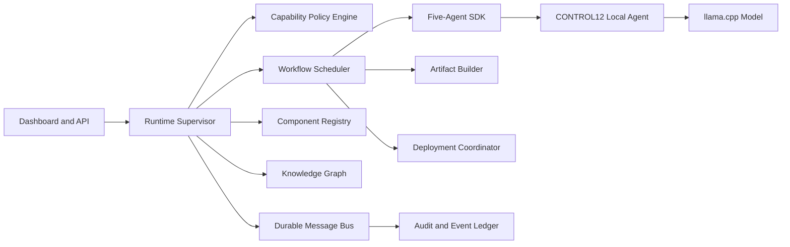

# CONTROL12 Sovereign Platform Architecture

The platform uses five immutable governance roles—planner, engineer, artifact, operations, verifier—while provider plugins remain capability manifests subject to policy, approval, audit, and provenance controls.

## Invariants

1. Production deployments require digest-pinned images.
2. High-risk actions require explicit approval according to environment policy.
3. Every event and component has a SHA-256 digest.
4. Artifact payloads and manifests are written separately and hashed.
5. Agent execution uses the evidence-grounded local-agent API.
6. Mutating APIs can require a bearer token.
7. Containers run non-root with dropped capabilities and read-only filesystems.
